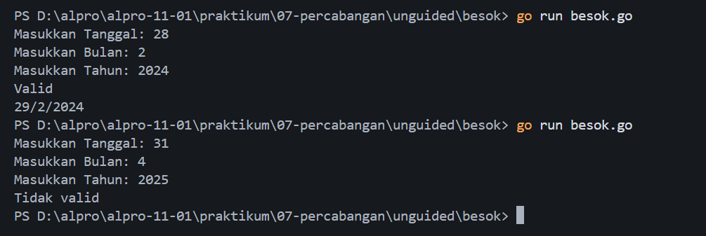
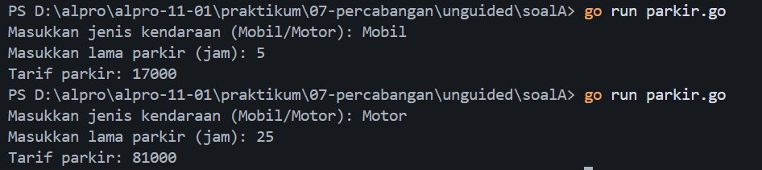

# <h1 align="center">Laporan Praktikum Modul 07 - Percabangan</h1>
<p align="center">Muhamad Nawaf Abduh - 109092630003</p>

## Dasar Teori
Percabangan adalah struktur kontrol yang memungkinkan program memilih jalur eksekusi tertentu berdasarkan kondisi yang diberikan. Tanpa percabangan, program hanya berjalan secara sekuensial dari atas ke bawah. Dalam bahasa Go, terdapat dua mekanisme utama untuk percabangan, yaitu pengkondisian (`if-else`, `else-if`) dan `switch-case`.

### if-else
`if-else` adalah struktur percabangan paling dasar. Blok `if` akan dieksekusi apabila kondisi bernilai `true`, sedangkan blok `else` akan dieksekusi apabila kondisi bernilai `false`.

```go
if kondisi {
    // dijalankan jika kondisi true
} else {
    // dijalankan jika kondisi false
}
```

### else-if
`else-if` digunakan ketika terdapat lebih dari dua kemungkinan kondisi yang perlu diperiksa secara berurutan. Program akan mengevaluasi setiap kondisi dari atas ke bawah, dan kondisi pertama yang bernilai `true` blok kode di dalamnya akan dieksekusi. Jika tidak ada yang terpenuhi, blok `else` terakhir yang akan dijalankan.
```go
if kondisi1 {
    // dijalankan jika kondisi1 true
} else if kondisi2 {
    // dijalankan jika kondisi2 true
} else {
    // dijalankan jika semua kondisi false
}
```

### switch-case
`switch-case` adalah struktur percabangan yang mencocokkan nilai suatu ekspresi/variabel dengan beberapa kemungkinan nilai (`case`) yang nilainya sudah kita ketahui sebelumnya.

```go
switch ekspresi {
case nilai1:
    // dijalankan jika ekspresi == nilai1
case nilai2:
    // dijalankan jika ekspresi == nilai2
default:
    // dijalankan jika tidak ada case yang cocok
}
```

### Perbedaan if-else dan switch-case
- `if-else` lebih fleksibel karena setiap kondisi bisa berupa ekspresi boolean yang berbeda-beda (misalnya perbandingan rentang nilai atau operasi logika gabungan).

- `switch-case` lebih cocok dan lebih rapi digunakan ketika kita membandingkan satu variabel terhadap beberapa nilai tetap yang sudah diketahui (misalnya jenis operator, nama hari). 

Gunakan `if-else` saat kondisi bersifat kompleks atau melibatkan rentang (misal: `x > 10 && x < 50`). 

Gunakan `switch-case` kalau kamu hanya perlu mencocokkan satu nilai dengan beberapa pilihan yang sudah pasti. Misalnya hari. Dengan begitu, kode jadi lebih rapi dan lebih mudah dibaca.

## Guided
### 1. kabisat.go
```go
package main
import "fmt"

func main() {
	var tahun int
	fmt.Scan(&tahun)

	if (tahun % 4 == 0 && tahun % 100 != 0) || (tahun % 400 == 0) {
		fmt.Printf("Ya, %d Merupakan tahun kabisat", tahun)
	} else {
		fmt.Printf("Tidak, %d Bukan tahun kabisat", tahun)
	}
}
```

#### Deskripsi
`kabisat.go` Merupakan program untuk menentukan apakah suatu tahun yang dimasukkan merupakan tahun kabisat atau bukan.

### 2. kalkulator.go
```go
package main

import "fmt"

func main() {
	var (
		op string
		a, b int
	)

	fmt.Scan(&a, &op, &b)

	switch op {
	case "+":
		fmt.Println(a + b)
	case "-":
		fmt.Println(a - b)
	case "*":
		fmt.Println(a * b)
	case "/":
		if b == 0 {
			fmt.Println("Tidak bisa dibagi dengan nol")
		} else {
			fmt.Printf("%.2f ", float64(a) / float64(b))
		} 
	case "%":
		if b == 0 {
			fmt.Println("Tidak bisa dibagi dengan nol")
		} else {
			fmt.Println(a%b)
		}
	default:
		fmt.Println("Operator tidak valid")
		return
	}
}
```

#### Deskripsi
`kalkulator.go` Merupakan program untuk melakukan operasi aritmatika sederhana (penjumlahan `+`, pengurangan `-`, perkalian `*`, pembagian `/`, dan modulus`%`) berdasarkan operator yang dimasukkan pengguna. Program menggunakan `switch-case` untuk mencocokkan operator, dan terdapat validasi pembagian dengan nol pada operator `/` dan `%`.

### 3. ongkir.go
```go
package main

import (
	"fmt"
	"math"
)

func main() {
	var (
		berat            float64
		zona, tarifPerKg int
		layanan          string
	)

	fmt.Scan(&berat, &zona, &layanan)
	if berat > 30 {
		fmt.Println("Berat melebihi batas maksimum (30kg)")
		return
	}

	switch zona {
	case 1:
		tarifPerKg = 10000
	case 2:
		tarifPerKg = 15000
	case 3:
		tarifPerKg = 25000
	default:
		fmt.Println("Zona tidak valid!")
		return
	}

	beratBulat := int(math.Ceil(berat))
	total := beratBulat * tarifPerKg

	switch layanan {
	case "Express":
		total += total / 2
	case "Reguler":
		total += 0
	default:
		fmt.Println("Layanan tidak valid")
		return
	}

	fmt.Printf("%d\n%d", beratBulat, total)
}
```

#### Deskripsi
`ongkir.go` Merupakan program untuk menghitung ongkos kirim paket berdasarkan berat, zona pengiriman, dan jenis layanan. Berat dibulatkan ke atas menggunakan `math.Ceil`, tarif per kg ditentukan oleh zona (1, 2, atau 3) melalui `switch-case`, dan jika layanan yang dipilih adalah `Express` maka total ongkir ditambah 50% dari tarif awal. Program juga memvalidasi berat maksimum 30kg.

## Unguided
### 1. besok.go
```go
package main

import "fmt"

func main() {
	var tanggal, bulan, tahun int

	fmt.Print("Masukkan Tanggal: ")
	fmt.Scan(&tanggal)

	fmt.Print("Masukkan Bulan: ")
	fmt.Scan(&bulan)

	fmt.Print("Masukkan Tahun: ")
	fmt.Scan(&tahun)

	// Tahun kabisat
	kabisat := (tahun%4 == 0 && tahun%100 != 0) || tahun%400 == 0

	// Hari maksimum pada bulan tersebut
	hariMaks := 0
	
	switch bulan {
	case 1, 3, 5, 7, 8, 10, 12:
		hariMaks = 31
	case 4, 6, 9, 11:
		hariMaks = 30
	case 2:
		if kabisat {
			hariMaks = 29
		} else {
			hariMaks = 28
		}
	}

	// Validasi tanggal
	if tahun <= 0 || hariMaks == 0 || tanggal < 1 || tanggal > hariMaks {
		fmt.Println("Tidak valid")
		return
	}

	// Hitung tanggal besok
	if tanggal < hariMaks {
		tanggal++
	} else {
		tanggal = 1
		if bulan == 12 {
			bulan = 1
			tahun++
		} else {
			bulan++
		}
	}

	fmt.Println("Valid")
	fmt.Printf("%d/%d/%d\n", tanggal, bulan, tahun)
}
```

#### Output


#### Deskripsi
`besok.go` Merupakan program untuk menentukan tanggal hari berikutnya (besok) dari tanggal,bulan, tahun yang dimasukkan pengguna dan apakah tanggal,bulan,tahun yang dimasukkan itu valid atau tidak.

Program menerima input `tanggal`, `bulan`, dan `tahun`. Kemudian program mengecek apakah tahun tersebut kabisat untuk menentukan jumlah hari maksimum pada bulan Februari (28 atau 29).
```go
kabisat := (tahun%4 == 0 && tahun%100 != 0) || tahun%400 == 0
```
Jumlah hari maksimum tiap bulannya ditentukan menggunakan `switch-case`. Setelah itu program memvalidasi apakah tanggal yang dimasukkan itu valid atau tidak. Jika valid, program menghitung tanggal dihari esok. Apabila tanggal belum mencapai hari terakhir bulan tersebut maka `tanggal` ditambah 1, namun jika sudah di hari terakhir pada bulan tersebut, maka tanggal direset ke 1 dan `bulan` ditambah 1, dan jika bulannya sudah Desember (12 atau bulan terakhir) maka bulan direset ke 1 dan `tahun` ditambah 1.

### 2. parkir.go
`NIM: 109092630003 mod 3 = 0 `
maka saya mengerjakan `soalA` `yaitu parkir.go`
```go
package main

import "fmt"

func main() {
	var (
		jenis string
		jam,tarif   int
	)

	fmt.Print("Masukkan jenis kendaraan (Mobil/Motor): ")
	fmt.Scan(&jenis)

	fmt.Print("Masukkan lama parkir (jam): ")
	fmt.Scan(&jam)

	if jam < 1 {
		fmt.Println("Lama parkir tidak valid")
		return
	}

	switch jenis {
	case "Mobil", "mobil":
		tarif = 5000 + (jam-1)*3000
		if jam > 24 {
			tarif += 50000
		}
	case "Motor", "motor":
		tarif = 3000 + (jam-1)*2000
		if jam > 24 {
			tarif += 30000
		}
	default:
		fmt.Println("Jenis kendaraan tidak valid")
		return
	}

	fmt.Println("Tarif parkir:", tarif)
}
```

#### Output


#### Deskripsi
`parkir.go` Merupakan program untuk menghitung tarif parkir kendaraan berdasarkan jenis kendaraan dan lama parkir nya dalam satuan jam. Program menerima input `jenis` kendaraan (Mobil/Motor) dan `jam` lama parkir. Jika `jam < 1` maka program menampilkan pesan tidak valid.
```go
if jam < 1 {
    fmt.Println("Lama parkir tidak valid")
    return
}
```
Tarif dihitung menggunakan `switch-case` berdasarkan jenis kendaraan. Untuk Mobil, tarif jam pertama `5000` dan setiap jam berikutnya `3000`. Untuk Motor, tarif jam pertama `3000` dan setiap jam berikutnya `2000`. Jika lama parkir melebihi 24 jam, maka dikenakan denda tambahan `50000` untuk Mobil dan `30000` untuk Motor.

## Kesimpulan
Dari praktikum ini, saya jadi bisa lebih paham untuk menggunakan struktur percabangan di Go yaitu `if-else`, `else-if`, dan `switch-case`. 

`if-else` cocok digunakan untuk kondisi yang kompleks atau melibatkan rentang nilai, sedangkan `switch-case` lebih cocok ketika kita ingin mencocokkan satu nilai dengan beberapa pilihan yang sudah pasti, misalnya hari. Dengan begitu, kode jadi lebih rapi dan lebih mudah dibaca. Keduanya juga bisa dikombinasikan dalam satu program sesuai kebutuhan.

## Referensi
#### 1. Materi LMS Algoritma Pemrograman Pekan 6 - Percabangan 