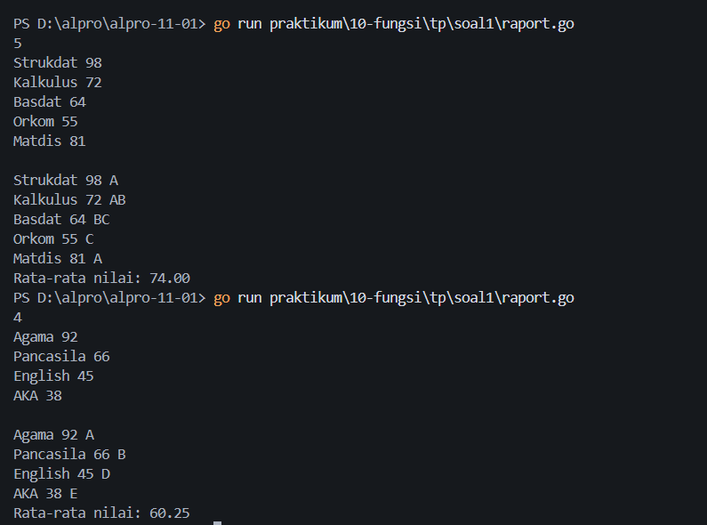
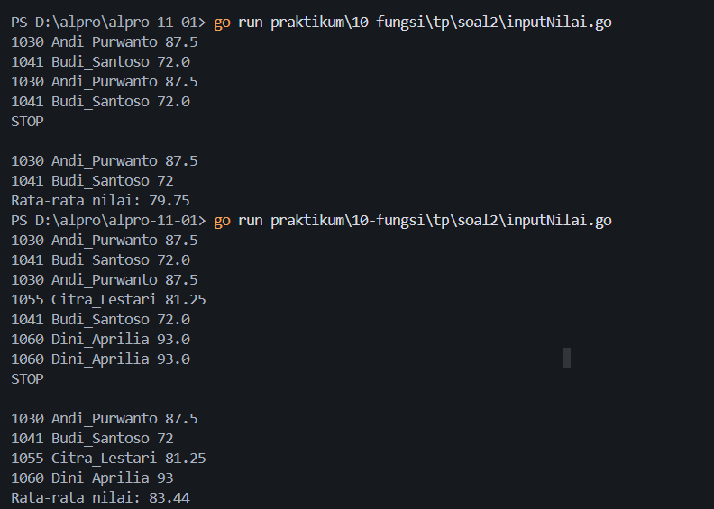

# <h1 align="center">Tugas Pendahuluan Modul 10 - Fungsi</h1>
<p align="center">Muhamad Nawaf Abduh - 109092630003</p>

### 1. raport.go

```go
package main
import "fmt"

const NMAX int = 999

type rapot struct {
	matkul string
	nilai  int
}

type tabRapot [NMAX]rapot

func nilaiHuruf(x int) string {
	if x > 80 && x <= 100 {
		return "A"
	} else if x > 70 && x <= 80 {
		return "AB"
	} else if x > 65 && x <= 70 {
		return "B"
	} else if x > 60 && x <= 65 {
		return "BC"
	} else if x > 50 && x <= 60 {
		return "C"
	} else if x > 40 && x <= 50 {
		return "D"
	} else if x >= 0 && x <= 40 {
		return "E"
	} else {
		return "Invalid"
	}
}

func rataRata(T tabRapot, n int) float64 {
	if n == 0 {
		return 0
	}
	var total int
	for i := 0; i < n; i++ {
		total += T[i].nilai
	}
	return float64(total) / float64(n)
}

func main() {
	var T tabRapot
	var n int

	fmt.Scan(&n)
	for i := 0; i < n; i++ {
		fmt.Scan(&T[i].matkul, &T[i].nilai)
	}
	fmt.Println()
	for i := 0; i < n; i++ {
		fmt.Println(T[i].matkul, T[i].nilai, nilaiHuruf(T[i].nilai))
	}
	fmt.Printf("Rata-rata nilai: %.2f\n", rataRata(T, n))
}
```

#### Output



#### Deskripsi
`raport.go` merupakan program untuk mencatat nilai rapot yang terdiri dari matkul dan nilainya. Data matkul dan nilainya disimpan dalam struct `rapot`
```go
type rapot struct {
	matkul string
	nilai  int
}
```
supaya data yang diinputkan dibaris sebelumnya tidak hilang, datanya disimpan di `array tabRapot`
```go
type tabRapot [NMAX]rapot
```
yang berkapasitas `NMAX = 999`

Lalu program ini akan menentukan nilai (huruf) apa yang didapatkan pada nilai masing-masing matkul berdasarkan rentang nilai nya. Logic untuk nilai huruf, berada pada function terpisah yaitu `func nilaiHuruf (...) ... {}` yang mengembalikan nilai hurufnya (string).

```go
func nilaiHuruf(x int) string {
	if x > 80 && x <= 100 {
		return "A"
	} else if x > 70 && x <= 80 {
		return "AB"
	} else if x > 65 && x <= 70 {
		return "B"
	} else if x > 60 && x <= 65 {
		return "BC"
	} else if x > 50 && x <= 60 {
		return "C"
	} else if x > 40 && x <= 50 {
		return "D"
	} else if x >= 0 && x <= 40 {
		return "E"
	} else {
		return "Invalid"
	}
}
```

lalu, Program ini akan menghitung nilai rata-rata dari total semua nilai masing-masing matkul pada rapot nya. Nilai rata-rata dihitung di function terpisah juga yaitu `func rataRata (...) ... {}` yang mengembalikan (`total`/ `n`) yang ber-tipe data `float64`

```go
func rataRata(T tabRapot, n int) float64 {
	if n == 0 {
		return 0
	}
	var total int
	for i := 0; i < n; i++ {
		total += T[i].nilai
	}
	return float64(total) / float64(n)
}
```

### 2. inputNilai.go

```go
package main
import "fmt"

const NMAX int = 100

type student struct {
	nim, name string
	grade float64
}

type students [NMAX]student

func cariNIM(T students, n int, nim string) int {
	for i := 0; i < n; i++ {
		if T[i].nim == nim {
			return i
		}
	}
	return -1
}

func rataRata(T students, n int) float64 {
	var total float64

	if n == 0 {
		return 0
	}
	
	for i := 0; i < n; i++ {
		total += T[i].grade
	}
	return total / float64(n)
}

func main() {
	var (
		T students
		nim, name string
		grade float64
		n int
	)

	for {
		_, err := fmt.Scan(&nim)
		if err != nil || nim == "STOP" {
			break
		}

		fmt.Scan(&name, &grade)

		if cariNIM(T, n, nim) == -1 && n < NMAX {
			T[n] = student{nim, name, grade}
			n++
		}
	}
	fmt.Println()
	for i := 0; i < n; i++ {
		fmt.Println(T[i].nim, T[i].name, T[i].grade)
	}

	fmt.Print("Rata-rata nilai: ", rataRata(T, n))
}
```

#### Output



#### Deskripsi
`inputNilai.go` Merupakan program untuk menginputkan nilai-nilai ujian mahasiswa. Menginputkan 1 baris yang berisi:
- `nim`, `nama`, dan `grade`

yang datanya disimpan dalam struct `student`
```go
type student struct {
	nim, name string
	grade float64
}
```
supaya data yang diinputkan dibaris sebelumnya tidak hilang, datanya disimpan di `array students`
```go
type students [NMAX]student
```
yang berkapasitas `NMAX = 100`

Program akan terus meminta menginputkan 1 baris input tersebut secara berulang dan perulangan baru akan berhenti ketika nim yang dimasukkan adalah `"STOP"`
```go
for {
	_, err := fmt.Scan(&nim)
	if err != nil || nim == "STOP" {
		break
	}
...
}
```

Program akan mencari nim terlebih dahulu dengan function `cariNIM(T, n, nim)`. Function ini akan mengecek data dari index pertama sampai data terakhir yang sudah disimpan, untuk memastikan tidak ada nim yang duplikat. Jika ada yang duplikat, dia akan mengembalikan index pertama yang memiliki nim tersebut sehingga nim duplikat yang baru dimasukkan tidak akan terpakai.
```go
func cariNIM(T students, n int, nim string) int {
	for i := 0; i < n; i++ {
		if T[i].nim == nim {
			return i
		}
	}
	return -1
}
```

Pada saat input data, data baru nya hanya akan disimpan jika fungsi `cariNIM` mengembalikan nilai `-1`, yaitu hanya ketika nim yg dimasukkan belum pernah dimasukkan sebelumnya.
```go
if cariNIM(T, n, nim) == -1 && n < NMAX {
	T[n] = student{nim, name, grade}
	n++
}
```
Kemudian program ini akan menampilkan data-data yang tersimpan

```go
for i := 0; i < n; i++ {
	fmt.Println(T[i].nim, T[i].name, T[i].grade)
}
```

lalu terakhir, program akan menampilkan nilai rata-rata yang dihitung menggunakan fungsi `rataRata` 
```go
func rataRata(T students, n int) float64 {
	var total float64

	if n == 0 {
		return 0
	}
	
	for i := 0; i < n; i++ {
		total += T[i].grade
	}
	return total / float64(n)
}
```
sama saja seperti pada `raport.go`

## Kesimpulan
Dengan adanya tp ini saya bisa lebih memahami gimana caranya supaya memecah fungsi menjadi bagian-bagian yang lebih kecil lalu memanfaatkannya di fungsi `main` nya (Pemrograman Modular). Dengan pendekatan seperti itu juga, fungsi-fungsi yang dipecah menjadi bagian-bagian kecil akan jadi `reuseable` atau dapat digunakan secara berulang(tinggal panggil saja fungsinya) tanpa harus menulis logicnya lagi.