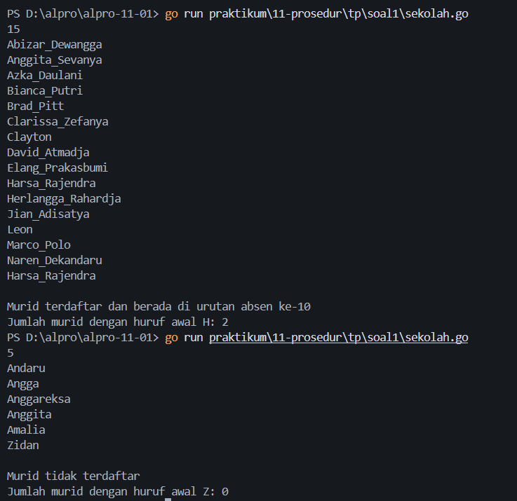
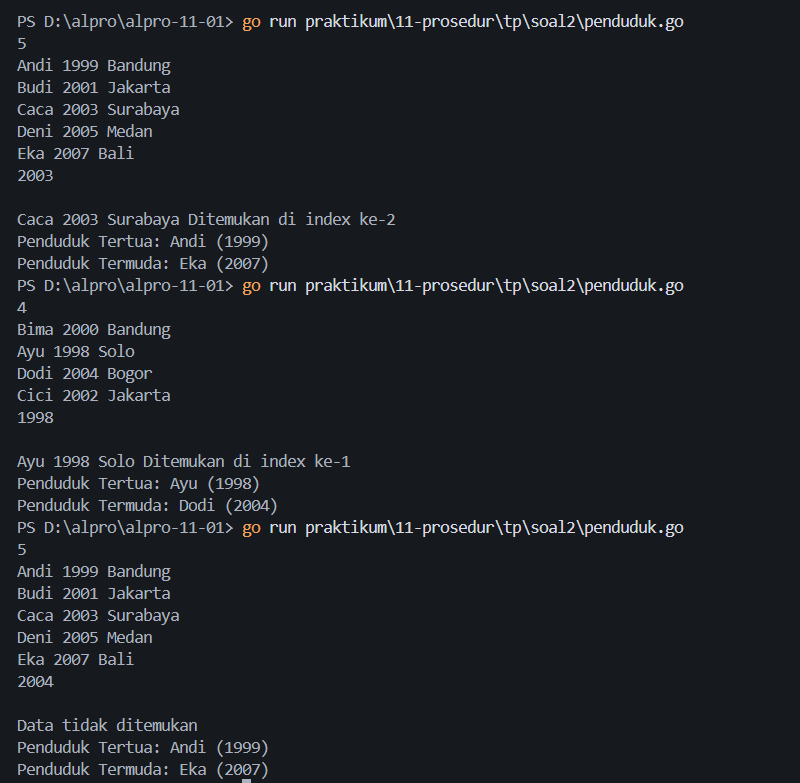

# <h1 align="center">Tugas Pendahuluan Modul 11 - Prosedur</h1>
<p align="center">Muhamad Nawaf Abduh - 109092630003</p>

### 1. sekolah.go

```go
package main

import (
	"fmt"
	"unicode"
)

const NMAX int = 1001
type tabMurid [NMAX]string

func cariMurid(T tabMurid, n int, nama string, posisi *int, ketemu *bool) {
	/*
		I.S. T[0..n-1] dan nama terdefinisi
		F.S. ketemu bernilai true dan posisi berisi urutan absen (mulai dari 1) jika nama ditemukan; jika tidak, ketemu bernilai false
	*/

	*ketemu = false
	for i := 0; i < n; i++ {
		if T[i] == nama {
			*ketemu = true
			*posisi = i + 1
			return
		}
	}
}

func hitungHuruf(T tabMurid, n int, h byte, jumlah *int) {
	/*
		IS : T[0..n-1] dan h terdefinisi
		FS : jumlah berisi banyaknya nama pada T yang diawali huruf h
	*/

	*jumlah = 0
	for i := 0; i < n; i++ {
		if T[i] != "" && T[i][0] == h {
			*jumlah++
		}
	}
}

func main() {
	var (
		T tabMurid
		n, posisi, jumlah int
		nama string
		ketemu bool
		h byte
	)

	// Daftar nama sejumlah n murid
	fmt.Scan(&n)
	for i := 0; i < n; i++ {
		fmt.Scan(&T[i])
	}
	// Cari murid
	fmt.Scan(&nama)
	fmt.Println()
	
	cariMurid(T, n, nama, &posisi, &ketemu)
	if ketemu {
		fmt.Printf("Murid terdaftar dan berada di urutan absen ke-%d\n", posisi)
	} else {
		fmt.Println("Murid tidak terdaftar")
	}

	// Hitung huruf
	h = nama[0]
	hitungHuruf(T, n, h, &jumlah)
	fmt.Printf("Jumlah murid dengan huruf awal %c: %d", unicode.ToUpper(rune(h)), jumlah)
}
```

#### Output



#### Deskripsi
`sekolah.go` Merupakan program untuk menyimpan daftar murid (sesuai urutan absen), mencari suatu murid terdaftar atau tidak, dan untuk menghitung ada berapa murid yang mempunyai inisial yang sama dengan murid yang dicari. 

Pertama, program meminta masukkan data-data sejumlah n muridnya terlebih dulu
```go
// Daftar nama sejumlah n murid
fmt.Scan(&n)
for i := 0; i < n; i++ {
	fmt.Scan(&T[i])
}
```
Data-datanya akan disimpan ke variabel T bertipe tabMurid[] yang memiliki kapasitas `NMAX = 1001`
```go
const NMAX int = 1001
type tabMurid [NMAX]string
```

Selanjutnya, program meminta masukkan `nama` untuk mencari salah satu murid lalu memanggil fungsi `cariMurid(...)`
```go
fmt.Scan(&nama)
fmt.Println()
cariMurid(T, n, nama, &posisi, &ketemu)
```

fungsi `cariMurid(...)`:
```go
func cariMurid(T tabMurid, n int, nama string, posisi *int, ketemu *bool) {
	/*
		I.S. T[0..n-1] dan nama terdefinisi
		F.S. ketemu bernilai true dan posisi berisi urutan absen (mulai dari 1) jika nama ditemukan; jika tidak, ketemu bernilai false
	*/

	*ketemu = false
	for i := 0; i < n; i++ {
		if T[i] == nama {
			*ketemu = true
			*posisi = i + 1
			return
		}
	}
}
```
...
fungsi ini akan mencari dari index 0 sampai n. Jika ada `nama` yang sama dengan `T[i]`(data-data yang telah tersimpan) maka `ketemu = true`, `posisi = i + 1`(posisi ini untuk urutan absen).

Output ketika `ketemu == true/false`:
```go
if ketemu {
	fmt.Printf("Murid terdaftar dan berada di urutan absen ke-%d\n", posisi)
} else {
	fmt.Println("Murid tidak terdaftar")
}
```

Selanjutnya adalah mencari data murid yang memiliki inisial yang sama dengan `nama` yang dicari sebelumnya:

menginisialisasi variabel `h` dengan nilai karakter pertama dari variabel `nama`
```go
h = nama[0]
```

Panggil fungsi `hitungHuruf(...)`
```go
hitungHuruf(T, n, h, &jumlah)
```
fungsi `hitungHuruf(...)`:
```go
func hitungHuruf(T tabMurid, n int, h byte, jumlah *int) {
	/*
		IS : T[0..n-1] dan h terdefinisi
		FS : jumlah berisi banyaknya nama pada T yang diawali huruf h
	*/

	*jumlah = 0
	for i := 0; i < n; i++ {
		if T[i] != "" && T[i][0] == h {
			*jumlah++
		}
	}
}
```
Fungsi terus mencari dari index 0 sampai n untuk menemukan `h` yang sama dengan `T[i][0]` (karakter pertama pada data diindex ke-i). Jika ada, maka nilai dari `jumlah + 1`

lalu Outputnya ditampilkan
```go
fmt.Printf("Jumlah murid dengan huruf awal %c: %d", unicode.ToUpper(rune(h)), jumlah)
```

### 2. penduduk.go

```go
package main 
import "fmt"

const NMAX int = 1000
type penduduk struct {
	nama string
	tahunLahir int
	kotaAsal string
}

type tabPenduduk [NMAX]penduduk

func cariTahun(T tabPenduduk, n, th int, idx *int) {
	*idx = -1
	for i := 0; i < n; i++ {
		if T[i].tahunLahir == th {
			*idx = i
			break
		}
	}
}

func tertuaTermuda(T tabPenduduk, n int, tua, muda *penduduk) {
	*tua = T[0]
	*muda = T[0]

	// tertua termuda
	for i := 0; i < n; i++ {
		if T[i].tahunLahir < tua.tahunLahir {
			*tua = T[i]
		}
	
		if T[i].tahunLahir > muda.tahunLahir {
			*muda = T[i]
		} 
	}
}

func main () {
	var (
		T tabPenduduk
		tua, muda penduduk
		n,tahunLahir,idx int
	)
	
	fmt.Scan(&n)
	for i := 0; i < n; i++ {
		fmt.Scan(&T[i].nama, &T[i].tahunLahir, &T[i].kotaAsal)
	}	

	// Cari tahun
	fmt.Scan(&tahunLahir)
	cariTahun(T, n, tahunLahir, &idx)

	fmt.Println()

	if idx != -1 {
		fmt.Printf("%s %d %s Ditemukan di index ke-%d\n", T[idx].nama, T[idx].tahunLahir, T[idx].kotaAsal, idx)
	} else {
		fmt.Println("Data tidak ditemukan")
	}

	// Sorting penduduk tertua & termuda
	tertuaTermuda(T, n, &tua, &muda)
	fmt.Printf("Penduduk Tertua: %s (%d)\n", tua.nama, tua.tahunLahir)
	fmt.Printf("Penduduk Termuda: %s (%d)\n", muda.nama, muda.tahunLahir)
}
```

#### Output


#### Deskripsi
`penduduk.go` Merupakan program untuk menyimpan data penduduk yang datanya terdiri dari: 
- Nama
- Tahun lahir
- Kota asal

```go
type penduduk struct {
	nama string
	tahunLahir int
	kotaAsal string
}
```
data-data tersebut disimpan ke dalam array pada variabel `T` berdasarkan index nya.
```go
type tabPenduduk [NMAX]penduduk
```
yang berkapasitas `NMAX = 1000`

Pertama, program meminta masukkan data-data sejumlah n penduduknya terlebih dulu
```go
fmt.Scan(&n)
for i := 0; i < n; i++ {
	fmt.Scan(&T[i].nama, &T[i].tahunLahir, &T[i].kotaAsal)
}
```

Selanjutnya, program meminta masukkan `tahunLahir` untuk mencari salah satu penduduk yang tahun lahir nya sama dengan `tahunLahir` yang dimasukkan. Lalu panggil fungsi `cariTahun(...)`
```go
fmt.Scan(&tahunLahir)
cariTahun(T, n, tahunLahir, &idx)
```

fungsi `cariTahun(...)`:
```go
func cariTahun(T tabPenduduk, n, th int, idx *int) {
	*idx = -1
	for i := 0; i < n; i++ {
		if T[i].tahunLahir == th {
			*idx = i
			break
		}
	}
}
```
...
fungsi ini akan mencari dari index 0 sampai n. Jika ada `tahunLahir` yang sama dengan `T[i].tahunLahir`(data tahunLahir yang telah tersimpan pada array) maka `idx = i`(index dimana data ditemukan). Jika tidak ditemukan, `idx = -1`

Output ketika `idx != -1` (ditemukan) dan saat tidak ditemukan:
```go
if idx != -1 {
	fmt.Printf("%s %d %s Ditemukan di index ke-%d\n", T[idx].nama, T[idx].tahunLahir, T[idx].kotaAsal, idx)
} else {
	fmt.Println("Data tidak ditemukan")
}
```

Selanjutnya adalah mencari penduduk tertua dan termuda dari data-data yang telah tersimpan:

Panggil fungsi `tertuaTermuda(...)`
```go
tertuaTermuda(T, n, &tua, &muda)
```

fungsi `tertuaTermuda(...)`:
```go
func tertuaTermuda(T tabPenduduk, n int, tua, muda *penduduk) {
	*tua = T[0]
	*muda = T[0]

	for i := 0; i < n; i++ {
		if T[i].tahunLahir < tua.tahunLahir {
			*tua = T[i]
		}
		if T[i].tahunLahir > muda.tahunLahir {
			*muda = T[i]
		}
	}
}
```
Fungsi ini menginisialisasi `tua` dan `muda` dengan data penduduk pertama `T[0]`. Lalu terus mencari dari index 0 sampai n, jika `T[i].tahunLahir < tua.tahunLahir` maka `tua` diperbarui dengan `T[i]`(karena tahun lahir lebih kecil berarti orangnya lebih tua). Begitu juga sebaliknya, jika `T[i].tahunLahir > muda.tahunLahir` maka `muda` diperbarui dengan `T[i]`.

lalu Outputnya ditampilkan
```go
fmt.Printf("Penduduk Tertua: %s (%d)\n", tua.nama, tua.tahunLahir)
fmt.Printf("Penduduk Termuda: %s (%d)\n", muda.nama, muda.tahunLahir)
```

## Kesimpulan
Dengan adanya tp ini saya bisa lebih memahami gimana caranya supaya memecah sebuah logic menjadi bagian-bagian yang lebih kecil lalu memanfaatkannya di fungsi main atau subprogram lainnya (Konsep Pemrograman Modular). Saya juga menjadi paham apa perbedaan Fungsi dan Prosedur. Keduanya hampir sama, tapi yang membedakannya yaitu: Fungsi harus mengembalikan suatu nilai melalui return. Sedangkan Prosedur tidak me-return nilai apapun, namun tetap bisa mengubah nilai dari luar melalui parameter pointer yang ditandai dengan `*` pada tipe data parameter nya.