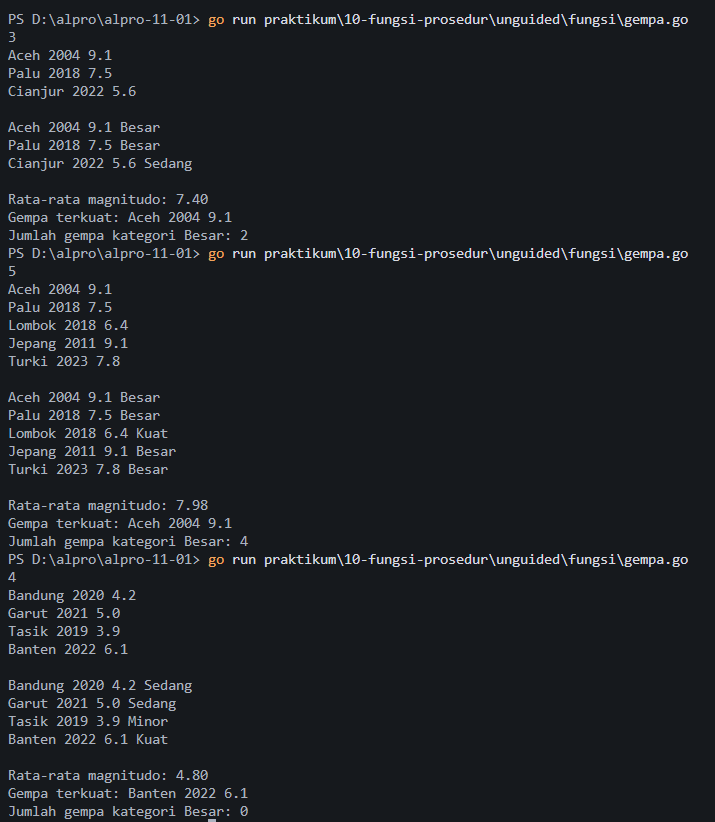
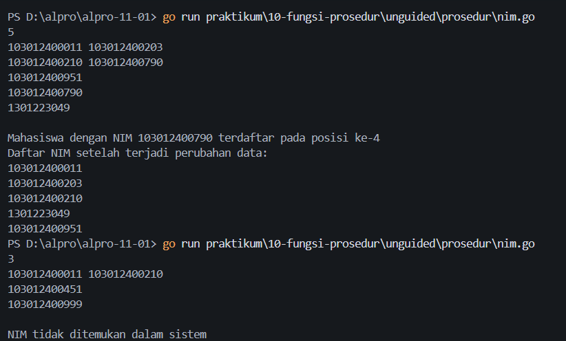

# <h1 align="center">Laporan Praktikum Modul 10 - Pemrograman Modular</h1>
<p align="center">Muhamad Nawaf Abduh - 109092630003</p>

## Dasar Teori
### Pemrogramam Modular
Pemrograman modular merupakan suatu pendekatan atau konsep di mana suatu program yang besar dan rumit dipecah-pecah menjadi beberapa bagian yang lebih kecil dan sederhana yang dikenal dengan istilah `subprogram`.

Subprogram umumnya dibedakan menjadi 2 jenis, yaitu `fungsi` dan `prosedur`. Di Golang, untuk menmgimplementasika subprogram fungsi dan prosedur kita hanya dapat menggunakan kata kunci `func` namun dengan pendekatan yang berbeda. Perbedaannya ada pada:
- Fungsi akan me-return suatu nilai 
- Sedangkan procedure tidak me-return apapun

### 1. Fungsi
Fungsi merupakan sebuah rangkaian instruksi yang memberikan atau menghasilkan suatu nilai, di mana kita menginputkan suatu nilai dan fungsi akan mengembalikan suatu nilai juga setelah input tersebut selesai diolah. Oleh karena itu, fungsi selalu menghasilkan/mengembalikan nilai.

Ciri-ciri subprogram (fungsi):
- ada deklarasi tipe data dari nilai yang akan dikembalikan
- ada kata kunci `return` dalam badan subprogram

Contoh:
```go
func pennjumlahan(a,b int) int {
    return a+b
}

func main() {
    var a,b int
    fmt.Scan(&a &b)

    fmt.Println(penjumlahan(a, b)) // fungsi penjumlahan dipanggil
}
```
### 2. Prosedur
Prosedur dapat dianggap sebagai potongan beberapa instruksi program menjadi suatu instruksi baru yang dibuat untuk mengurangi kerumitan dari kode program yang kompleks pada suatu program yang besar. Prosedur memiliki parameter formal dan parameter aktual. 

Parameter formal adalah parameter yang dideklarasikan di dalam `()` setelah nama func nya
```go
func prosedur(..., ... int) {...}
```
Sedangkan parameter aktual merupakan argumen atau nilai atau ekspresi yang akan dikirimkan saat fungsi/prosuder tersebut dipanggil

Suatu subprogram dikatakan prosedur apabila:
- Tidak ada deklarasi tipe data dari nilai yang akan dikembalikan. Karena prosedur tidak mengembalikan nilai apapun.
- Tidak ada kata kunci `return`

Contoh:
```go
func pnnjumlahan(a,b int) {
    fmt.Println(a+b)
}

func main() {
    var a,b int
    fmt.Scan(&a &b)

    penjumlahan(a,b) // langsung panggil func nya
}
```

Bedanya dengan subprogram (fungsi). `penjumlahan` di atas tidak punya tipe data kembalian dan tidak ada `return`. Pada prosedur, hasil/outputnya langsung diproses di dalam subprogram itu sendir. Selain itu, prosedur juga bisa mengubah nilai dari luar melalui parameter pointer yang ditandai dengan `*` pada tipe data parameternya, tanpa perlu me-return apapun.

#### Pass by Value
Merupakan pendekatan ketika nilai dari parameter aktual disalin ke parameter formal. Karena yang diterima adalah salinan, perubahan pada parameter di dalam prosedur tidak akan memengaruhi dan tidak dapat mengubah nilai variabel asalnya.

#### Pass by Reference (Pointer) *
Pointer adalah variabel yang menyimpan alamat dari variabel lain. Pada parameter prosedur, pointer digunakan supaya prosedur dapat mengubah nilai variabel yang dikirim dari `main` atau program pemanggil lainnya, tanpa perlu mengembalikan nilai menggunakan `return`.

Tipe data parameter pointer ditandai dengan `*`. Untuk mengirim alamat variabel saat prosedur dipanggil, gunakan `&` di depan nama variabel.

Contoh:
```go
func tambahSatu(n *int) {
	*n = *n + 1
}

func main() {
	angka := 5
	tambahSatu(&angka)
	fmt.Println(angka) // outputnya 6
}
```
Parameter `n *int` menerima alamat dari variabel `angka` yang dikirim melalui parameter aktual saat `tambahSatu` dipanggil di `func main`. Tanda `*` pada `*n` digunakan untuk mengubah nilai yang sebelumnya telah tersimpan di alamat tersebut. Tanda `&` pada argumen di pemanggilan `func tambahSatunya`. `&angka` mengirimkan alamat variabel `angka` ke prosedur.

## Guided 
### 1. player.go (Fungsi)
```go
package main

import "fmt"

const NMAX int = 999

type player struct {
	nickname string
	score    int
}

type tabPlayer [NMAX]player

func rataRata(T tabPlayer, n int) float64 {
	total := 0
	for i := 0; i < n; i++ {
		total += T[i].score
	}
	return float64(total) / float64(n)
}

func idxTertinggi(T tabPlayer, n int) int {
	idx := 0
	for i := 1; i < n; i++ {
		if T[i].score > T[idx].score {
			idx = i
		}
	}
	return idx
}

func hitungDiAtas(T tabPlayer, n int, batas float64) int {
	jumlah := 0
	for i := 0; i < n; i++ {
		if float64(T[i].score) > batas {
			jumlah++
		}
	}
	return jumlah
}

func main() {
	var (
		T tabPlayer
		n int
	)

	fmt.Scan(&n)
	for i := 0; i < n; i++ {
		fmt.Scan(&T[i].nickname, &T[i].score)
	}

	rata := rataRata(T, n)
	best := idxTertinggi(T, n)

	fmt.Println()
	fmt.Printf("Rata-rata skor: %.2f\n", rata)
	fmt.Printf("Player terbaik: %s (%d)\n", T[best].nickname, T[best].score)
	fmt.Printf("Jumlah player di atas rata-rata: %d\n", hitungDiAtas(T, n, rata))
}
```

#### Deskripsi
`player.go` merupakan program untuk menyimpan data nickname dan skor sejumlah n  player, lalu program akan menampilkan rata-rata skor, player dengan skor tertinggi, dan jumlah player yang skornya di atas rata-rata. Data setiap player disimpan dalam struct `player` dan dikumpulkan dalam array `tabPlayer`.

Logic nya dibagi menjadi beberapa fungsi: 
- `rataRata` menghitung rata-rata skor dari n player, 
- `idxTertinggi` mencari player dengan skor tertinggi, 
- `hitungDiAtas` menghitung ada berapa banyak player yang skor nya diatas rata-rata. 

### 2. sapi.go (Prosedur)
```go
package main
import "fmt"

const NMAX int = 10000
type Arr [NMAX]int

func bacaData(T *Arr, n int) {
	for i := 0; i < n; i++ {
		fmt.Scan(&T[i])
	}
}

func geserKanan(T *Arr, n int) {
	var temp int = T[n-1]

	for i := n - 1; i > 0; i-- {
		T[i] = T[i-1]
	}

	T[0] = temp
}

func cetak(T Arr, n int) {
	for i := 0; i < n; i++ {
		fmt.Print(T[i], " ")
	}
	fmt.Println()
}

func main() {
	var (
		n, k int
		T Arr
	)

	fmt.Scan(&n, &k)
	bacaData(&T, n)

	k = k % n 
	for i := 0; i < k ;i++ {
		geserKanan(&T, n)
	}

	cetak(T, n)
}
```

#### Deskripsi
`sapi.go` Merupakan program untuk membaca sejumlah bilangan, menggeser seluruh bilangan ke kanan sebanyak `k` posisi, lalu menampilkan hasilnya. Data dibaca dan disimpan dalam array `Arr`.

Prosedur `bacaData` mengisi array, sedangkan `geserKanan` memindahkan elemen terakhir ke posisi pertama dan menggeser elemen lainnya satu posisi ke kanan. Array dikirim menggunakan pointer (`*Arr`), Jadi perubahan pada prosedur tersebut langsung mengubah array yang digunakan di `main`. Nilai `k` dihitung dengan `k % n` agar jumlah pergeseran tidak melebihi banyak data, lalu menggunakan prosedur `cetak` untuk menampilkan hasilnya.

## Unguided
### 1. gempa.go (Fungsi)
```go
package main
import "fmt"

const NMAX int = 999

type gempa struct {
	nama      string
	tahun     int
	magnitudo float64
}

type tabGempa [NMAX]gempa

func kategori(m float64) string {
	var kategori string

	if m < 4.0 {
		kategori = "Minor"
		return kategori
	} else if m >= 4.0 && m < 6.0 {
		kategori = "Sedang"
		return kategori
	} else if m >= 6.0 && m < 7.0 {
		kategori = "Kuat"
		return kategori
	} else if m >= 7.0 {
		kategori = "Besar"
		return kategori
	} else {
		return "Tidak valid"
	}
}

// Hitung rata-rata magnitudo dari banyaknya gempa
func rataMagnitudo(T tabGempa, n int) float64 {
	var total float64
	for i := 0; i < n; i++ {
		total += T[i].magnitudo
	}
	return total / float64(n)
}

// Gempa terkuat
func idxTerkuat(T tabGempa, n int) int {
	idx := 0
	for i := 1; i < n; i++ {
		if T[i].magnitudo > T[idx].magnitudo {
			idx = i
		}
	}
	return idx
}

// Hitung banyaknya gempa besar
func hitungKategori(T tabGempa, n int, k string) int {
	jumlah := 0
	for i := 0; i < n; i++ {
		if kategori(T[i].magnitudo) == k {
			jumlah++
		}
	}
	return jumlah
}

func main() {
	var (
		T tabGempa
		n int
	)
	fmt.Scan(&n)

	for i := 0; i < n; i++ {
		fmt.Scan(&T[i].nama, &T[i].tahun, &T[i].magnitudo)
	}

	// daftar gempa beserta kategorinya
	for i := 0; i < n; i++ {
		fmt.Printf("%s %d %.1f %s\n", T[i].nama, T[i].tahun, T[i].magnitudo, kategori(T[i].magnitudo))
	}

	fmt.Printf("Rata-rata magnitudo: %.2f\n", rataMagnitudo(T, n))

	k := idxTerkuat(T, n)
	fmt.Printf("Gempa terkuat: %s %d %.1f\n", T[k].nama, T[k].tahun, T[k].magnitudo)

	fmt.Printf("Jumlah gempa kategori Besar: %d\n", hitungKategori(T, n, "Besar"))
}
```

#### Output


#### Deskripsi
`gempa.go` merupakan program untuk menyimpan data-data sejumlah n gempa, yaitu: nama, tahun, dan magnitudo gempa yang data-datanya disimpan di Array `tabGempa`. Program akan menampilkan setiap gempa beserta kategorinya, rata-rata magnitudo, gempa dengan magnitudo tertinggi, dan jumlah gempa berkategori "Besar".

Fungsi `kategori` menentukan kategori gempa berdasarkan retnang nilai magnitudo gempa, `rataMagnitudo` menghitung rata-rata magnitudo, `idxTerkuat` mencari data gempa terkuat, `hitungKategori` menghitung berapa banyak data yang kategorinya sesuai dengan kategori yang diminta (disini yang berkategori "Besar").

### 2. nim.go (Prosedur)
```go
package main

import "fmt"

const NMAX int = 2002
type tabNIM [NMAX]int

func cariNIM(T tabNIM, n, x int, idx *int) {
	*idx = -1
	i := 0
	// berhenti begitu ketemu, kalau ada NIM kembar yang diambil yang pertama
	for i < n && *idx == -1 {
		if T[i] == x {
			*idx = i
		}
		i++
	}
}

func ubahNIM(T *tabNIM, idx, baru int) {
	T[idx] = baru
}

func cetak(T tabNIM, n int) {
	for i := 0; i < n; i++ {
		fmt.Println(T[i])
	}
}

func main() {
	var (
		T tabNIM
		n int
		x int
		idx int
		baru int
	)

	fmt.Scan(&n)
	for i := 0; i < n; i++ {
		fmt.Scan(&T[i])
	}
	fmt.Scan(&x)

	cariNIM(T, n, x, &idx)

	if idx == -1 {
		fmt.Println("NIM tidak ditemukan dalam sistem")
	} else {
		// NIM pengganti hanya dibaca kalau NIM x ketemu
		fmt.Scan(&baru)
		ubahNIM(&T, idx, baru)

		fmt.Println()
		fmt.Printf("Mahasiswa dengan NIM %d terdaftar pada posisi ke-%d\n", x, idx+1)
		fmt.Println("Daftar NIM setelah terjadi perubahan data:")
		cetak(T, n)
	}
}
```

#### Output


#### Deskripsi
`nim.go` merupakan program untuk menyimpan daftar NIM, mencari NIM yang dimasukkan, dan menggantinya jika ditemukan. Daftar NIM disimpan dalam array `tabNIM`.

Prosedur `cariNIM` mencari data dari awal array dan mengisi `idx` melalui pointer dengan index pertama yang cocok, atau `-1` jika NIM tidak ditemukan karena index array tidak mungkin nilainya negatif. Jika berhasil ditemukan, `main` membaca NIM pengganti dan memanggil prosedur `ubahNIM`. Prosedur `ubahNIM` menerima pointer ke array sehingga perubahan nilai pada index yang ditemukan nya tersimpan pada daftar aslinya. Lalu terakhir, prosedur `cetak` menampilkan daftar NIM yang sudah diperbarui.

## Kesimpulan
Ketika kita membuat suatu projek yang skalanya mulai membesar, jika kita terus menerus menulis kode nya pada 1 program, kedepannya akan sulit untuk di ..., Jadi disitu lah konsep pemrograman modular diperlukan, yaitu dengan cara menggunakan subprogram. Kita memecah program yang besar menjadi bagian bagian yang lebih kecil dan sederhana, sehingga kedepannya, ketika kita mencari suatu logic untk program tertentu kita atau bahkan orang lain lebih mudah mencari dan me-maintenance nya. Tidak hanya itu, subprogram yang telah dibuat pun dapat digunakan kembali ke fungsi-fungsi yang membutuhkan, jadi kita tidak perlu repot-repot menulis kode dengan logic yang sama secara berulang.

Subprogram dibedakan menjadi 2 jenis, yaitu `fungsi` dan `prosedur`. Keduanya sama-sama ditulis menggunakan kata kunci `func` namun tetap memiliki perbedaan. Perbedaannya ada pada:
- Fungsi akan me-return suatu nilai 
- Sedangkan procedure tidak me-return apapun

## Referensi
#### 1. Modul pembelajaran Fungsi & Prosedur (Modul 9 & 10)