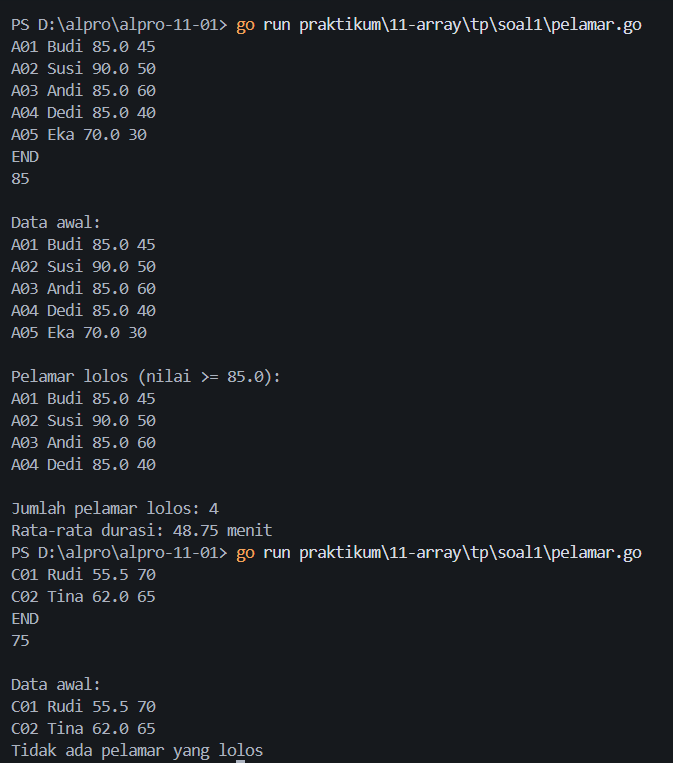
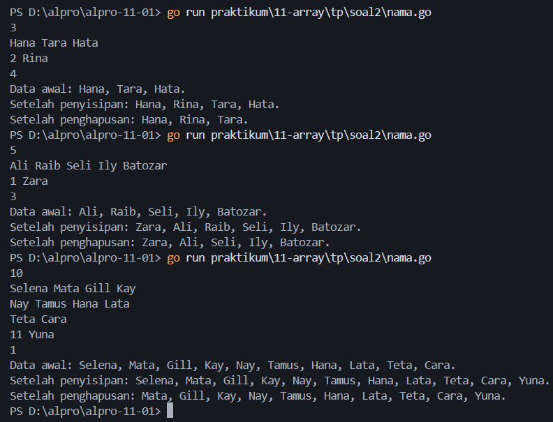

# <h1 align="center">Tugas Pendahuluan Modul 11 - Array</h1>
<p align="center">Muhamad Nawaf Abduh - 109092630003</p>

### 1. pelamar.go
```go
package main
import "fmt"

const NMAX int = 100
type applicant struct {
	id, name     string
	testGrade    float64
	testDuration int
}

type applicants [NMAX]applicant

func bacaPelamar(A *applicants, n *int) {
	var id string
	*n = 0
	fmt.Scan(&id)
	for id != "END" && *n < NMAX {
		A[*n].id = id
		fmt.Scan(&A[*n].name, &A[*n].testGrade, &A[*n].testDuration)
		*n++
		fmt.Scan(&id)
	}
}

func cetakPelamar(A applicants, n int) {
	for i := 0; i < n; i++ {
		fmt.Printf("%s %s %.1f %d\n", A[i].id, A[i].name, A[i].testGrade, A[i].testDuration)
	}
}

func salinLolos(A applicants, n int, batas float64, B *applicants, m *int) {
	*m = 0
	for i := 0; i < n; i++ {
		if A[i].testGrade >= batas {
			B[*m] = A[i]
			*m++
		}
	}
}

func rataDurasi(B applicants, m int) float64 {
	if m == 0 {
		return 0
	}
	total := 0
	for i := 0; i < m; i++ {
		total += B[i].testDuration
	}
	return float64(total) / float64(m)
}

func main() {
	var data, lolos applicants
	var n, m int
	var batas float64

	bacaPelamar(&data, &n)
	fmt.Scan(&batas)

	salinLolos(data, n, batas, &lolos, &m)

	fmt.Println("Data awal:")
	cetakPelamar(data, n)

	if m == 0 {
		fmt.Println("Tidak ada pelamar yang lolos")
	} else {
		fmt.Printf("Pelamar lolos (nilai >= %.1f):\n", batas)
		cetakPelamar(lolos, m)
		fmt.Println("Jumlah pelamar lolos:", m)
		fmt.Printf("Rata-rata durasi: %.2f menit\n", rataDurasi(lolos, m))
	}
}
```

##### Output


#### Deskripsi
`pelamar.go` merupakan program untuk menyimpan data-data pelamar yang terdiri dari ID, nama, nilai tes, dan durasi tes (dalam satuan menit). Setiap data direpresentasikan oleh tipe data struct yaitu `applicant`, lalu data-datanya disimpan di dalam array `applicants` yang berkapasitas `NMAX`.

Prosedur `bacaPelamar` menginput ID terlebih dahulu, lalu menginput nama, nilai, dan durasi selama ID bukan `"END"` dan array belum penuh. Jumlah data yang berhasil diinput disimpan melalui parameter pointer `*n`.
```go
for id != "END" && *n < NMAX {
	A[*n].id = id
	fmt.Scan(&A[*n].name, &A[*n].testGrade, &A[*n].testDuration)
	*n++
	fmt.Scan(&id)
}
```

Setelah selesai menginputkan data-data pelamar, yaitu ketika id yang diinputkan adalah "END" atau ketika sudah mencapai batas maksimum kapasitas array, program meminta untuk menginputkan batas (digunakan untuk nilai minimum supaya pelamar bisa lolos). Selanjutnya prosedur `salinLolos` memeriksa nilai setiap pelamar dan menyimpan data-data pelamar yang lolos ke parameter pointer B `B *applicants` lalu mengirimkan data nya dari pointer nya ke array `lolos`di `main`. Parameter pointer `m` menyimpan jumlah pelamar yang berhasil lolos.
```go
if A[i].testGrade >= batas {
	B[*m] = A[i]
	*m++
}
```

### 2. nama.go
```go
package main

import "fmt"

const NMAX int = 9999
type arrString [NMAX]string

func bacaData(A *arrString, n int) {
	for i := 0; i < n; i++ {
		fmt.Scan(&A[i])
	}
}

func cetakData(A arrString, n int) {
	for i := 0; i < n; i++ {
		if i > 0 {
			fmt.Print(", ")
		}
		fmt.Print(A[i])
	}
	fmt.Println(".")
}

func sisipData(A *arrString, n *int, p int, x string) {
	for i := *n; i > p-1; i-- {
		A[i] = A[i-1]
	}
	A[p-1] = x
	*n++
}

func hapusData(A *arrString, n *int, q int) {
	for i := q - 1; i < *n-1; i++ {
		A[i] = A[i+1]
	}
	*n--
}

func main() {
	var data arrString
	var n, p, q int
	var x string

	fmt.Scan(&n)
	bacaData(&data, n)
	fmt.Scan(&p, &x)
	fmt.Scan(&q)

	fmt.Print("Data awal: ")
	cetakData(data, n)

	sisipData(&data, &n, p, x)
	fmt.Print("Setelah penyisipan: ")
	cetakData(data, n)

	hapusData(&data, &n, q)
	fmt.Print("Setelah penghapusan: ")
	cetakData(data, n)
}
```

##### Output


#### Deskripsi
`nama.go` merupakan program untuk mengolah daftar nama yang disimpan dalam array `arrString`. Pertama program menginputkan n lalu daftar nama sebanyak n kali melalui prosedur `bacaData`, kemudian menginput posisi `p` serta nama yang akan disisipkan (variabel `x`), lalu menginputkan posisi `q` untuk nama yang akan dihapus (data nama yang index+1 nya == q akan dihapus).

lalu program memanggil prosedur `cetakData` untuk menampilkan daftar nama-nama (awal). Kemudian prosedur `sisipData` dipanggil untuk menyisipkan 1 data nama baru kedalam daftar nama yang sudah ada 
 
`sisipData` menggunakan indeks `p-1`. Sebelum menyimpan nama baru, supaya nama yang di sisipkan di taruh dalam index sebelah kirinya nilai `p` atau sama saja dengan `p-1` sehingga data nama pada index yg sama dengan nilai `p` hingga n nya bergeser 1 posisi ke kanan:
```go
for i := *n; i > p-1; i-- {
	A[i] = A[i-1]
}
A[p-1] = x
*n++
```

Kemudian daftar data nya (setelah disisipkan) ditampilkan kembali menggunakan prosedur `cetakData`

Setelah daftar ditampilkan kembali, prosedur `hapusData` menggunakan indeks `q-1` untuk menghapus nama yang indexnya sama dengan nilai `q`. Dan daftar data setelah data dengan dengan index tersebut telah dihapus ditampilkan kembali menggunakan prosedur `cetakData`

## Kesimpulan
Kita bisa membentuk/mengaliaskan sebuah tipe data baru dari tipe data yang sebelumnya sudah ada di Golang dengan nama tipe data baru supaya lebih mudah dibaca dan dipahami dengan cara 
```go
type TipeDataAlias = int
```
sekarang tipe data int = TipeDataAlias

Tipe bentukan juga bisa dibuat dari gabungan beberapa tipe data. Contohnya
```go
type applicant struct {
	id, name     string
	testGrade    float64
	testDuration int
}
```
`applicant` merupakan tipe bentukan berupa `struct` yang mengelompokkan id, nama, nilai tes, dan durasi tes dalam satu data. Dengan begitu, setiap data pelamar bisa disimpan dan diolah sebagai satu kesatuan. 

Array merupakan kumpulan elemen dengan tipe data yang sama dan dengan kapasitas yang sudah ditentukan (array statis). Setiap elemen pada array diurutkan dan dapat diakses menggunakan index. Index dimulai dari 0 bukan 1. Contoh:
```go
nama := [2]string{"Nawaf", "Abduh"}
```
Pada contoh tersebut, `nama[0]` berisi `"Nawaf"` dan `nama[1]` berisi `"Abduh"`. Jadi, index menunjukkan posisi elemen di dalam array. 